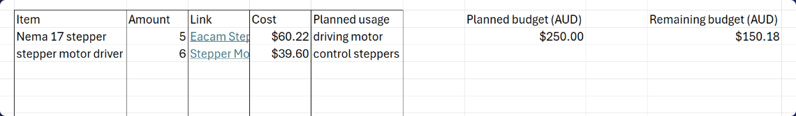

# 6 DOF Robotic Arm - Journal

**Total time spent: 18.17h**

---

## Entry 1 - ~16 Nov 2026

I started research for the project and defined some key parameters. not much to say for this early on, but did decide to do it with a friend, more fun and interesting, maybe build 2, one for each of us.

**Time spent: 1.22h**

---

## Entry 2 - ~17 Nov 2026

continued researching components and cost, still looking for a power supply, but have found a supplier of the bluetooth module that will work with the MEGA. i already have that so testing can start soon. (really wish funding was a reimbursement, so i can buy components and build, then get reimbursed for what i spend.)

i also designed the claw mechanism for the arm, i want it to be a soft grip, adaptable claw similar to some i found online, also known as a Fin Ray finger

**Time spent: 2.13h**

---

## Entry 3 - ~19 Nov 2026

did further research into what components i need, added things like micro switches for homing, plus a larger switch for between the power supply and the arduino as a master switch. also researched hardware for joints and stuff, probably going to use stainless dowel pins from Bambu lab, as theyre cheap and easy to find, serving as a low friction axle for planetary gearboxes on the joints. we are getting close to our budget, but i think its doable

**Time spent: 2.52h**

---

## Entry 4 - ~20 Nov 2026

Calculated all the necessary ratios for the joints and CADded them on onshape, i am using planetary gearboxes instead of cycloidal because they use less hardware and produce similar results.

found cheaper servos, saving budget and upped the total budget to $300 (not possible under $250 due to prices (why is everything so expensive?))

also calculated what module each stage has to be so the gears print nicely and dont snap under the load

**Time spent: 2.6h**

---

## Entry 5 - ~21 Nov 2026

prepared the carrier stage and gearbox enclosure for J1, whose ratio is 3.5:1, with the ring gear having 40 teeth, the planets having 12 and the sun having 16. also printing a gear of each size as necessary

**Time spent: 0.75h**

---

## Entry 6 - ~22 Nov 2026

did more work on components, added the bearings, bb's, servos and wire to the budget.

spent most of the time working on the base that will hold the arm to the table. the top section measures 160*190mm and is sized so that it fits all tables from 10-50mm thick, as it has a platform that can be adjusted and jack screws to tighten it against the table.

made a sketch of what the base will look like when its done, i have the light blue and just need the purple

**Time spent: 3h**

---

## Entry 7 - ~22 Nov 2026

designed J1 and its internal pathways, complete with a gearbox and motor, with space for cable routing and a groove for 6mm BB's to act as the bearing, but will need to do something about sideways forces, as currently the turning bit is held on by gravity alone.

I also began designing J2 and J3, even though its only a diagram at this point, and i will start CAD tomorrow, hopefully finish J2 at least

**Time spent: 2.83h**

---

## Entry 8 - ~23 Nov 2026

started working on J2, got the motor and gearbox in and am starting to work on the segment that connects J2 to J3. The ratio is 16:1, using a 2 stage planetary gearbox and the output is a 5x150mm rod that is serving as the axle, will add a printed cover to reinforce the joint, and am using 608 bearings on the inside to make the joint smoother. Our inspiration is the ARMOLD by sweep dynamics (see 3rd image)

**Time spent: 3.12h**
